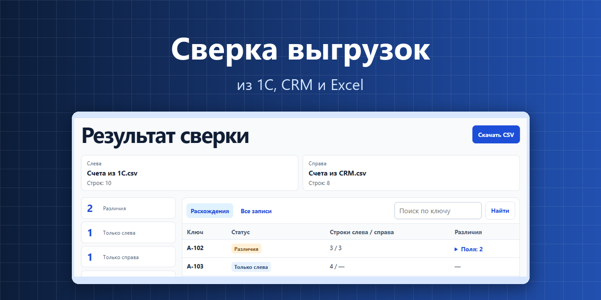
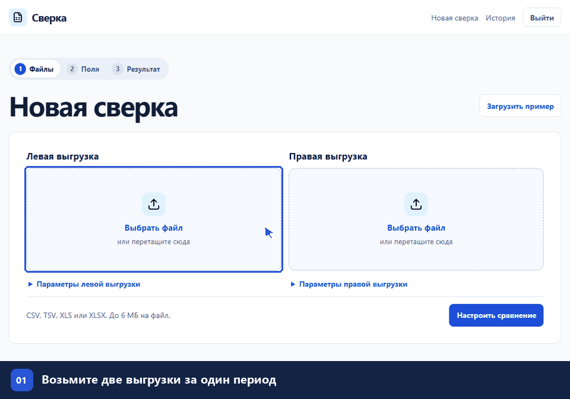
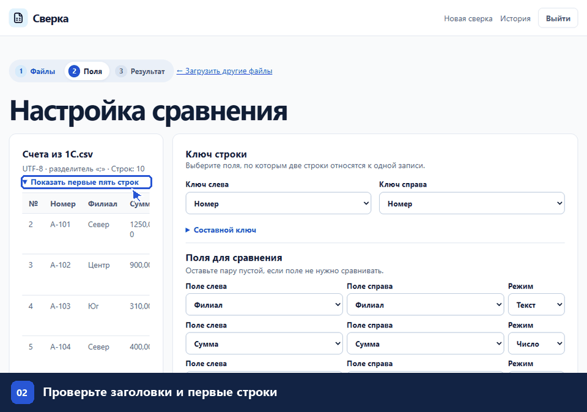
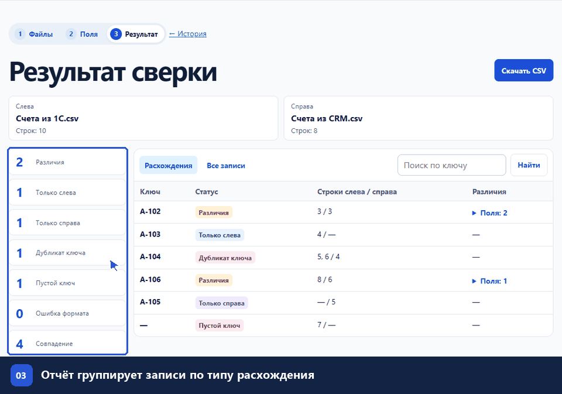
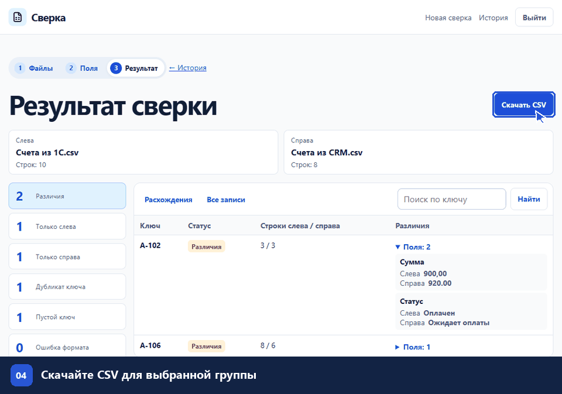

# Сверка выгрузок из 1С, CRM и Excel

## Что решает

Один и тот же счёт может быть оплачен в 1С и числиться открытым в CRM. Сверка сопоставляет две выгрузки и показывает, где расходятся суммы, даты или статусы. Ещё она находит пропавшие записи, дубли и строки без номера.

## Как это работает

### 1. Загрузите две выгрузки

Выберите два файла за один период. Например, счета из 1С слева и те же счета из CRM справа. Можно выбрать файлы или перетащить их в области загрузки.

### 2. Укажите, как сопоставлять строки

Выберите поле, по которому узнаёте одну запись в обеих таблицах. В примере это номер счёта. Затем укажите поля для проверки, например сумму, дату и статус. Для суммы можно задать допустимую разницу, например одну копейку.

### 3. Откройте расхождения

Выберите «Различия», «Только слева», «Только справа» или другую группу. Раскройте строку, чтобы увидеть значения из обоих источников и найти её в исходном файле по номеру строки.

### 4. Скачайте отчёт

Нажмите «Скачать CSV». В файл попадут строки выбранной группы. Готовую сверку можно найти в истории и открыть снова.

## Запуск демо

Нужны JDK 21 и Maven. В PowerShell из каталога проекта выполните:

~~~powershell
.\Start.ps1 -Build -Demo
~~~

[Открыть демо](http://127.0.0.1:8094/)

Вход: `demo@sverka.test` с паролем `DemoSverka2026!`.

В истории уже есть сверка счетов и сверка остатков. Кнопка «Загрузить пример» открывает настройку счетов. Исходные файлы также можно загрузить вручную.

- [Счета из 1С](src/main/resources/demo/orders-1c.csv) и [счета из CRM](src/main/resources/demo/orders-crm.csv).
- [Остатки из 1С](src/main/resources/demo/stock-1c.csv) и [пересчёт склада](src/main/resources/demo/stock-warehouse.csv).

Данные вымышлены и хранятся в отдельной базе `data/sverka-demo.mv.db`.

## Форматы и рабочий запуск

Сверка принимает CSV, TSV, XLS и XLSX. Размер каждого файла до 6 МБ, до 20 000 строк и 250 000 ячеек. Для Excel можно выбрать лист, а для любого файла указать строку с заголовками. Ключи читаются как текст, поэтому `001` и `1` считаются разными. Для Excel берутся результаты формул, сохранённые в файле.

Для рабочего запуска задайте `SVERKA_USER` и `SVERKA_PASSWORD`, затем выполните `.\Start.ps1 -Build`. Пароль должен содержать от 12 символов и занимать до 72 байт. Рабочая H2 хранится в `data/sverka.mv.db`. Для PostgreSQL используйте `SVERKA_JDBC_URL`, `SVERKA_JDBC_USER` и `SVERKA_JDBC_PASSWORD`. Для запуска за HTTPS-прокси укажите `SVERKA_BIND` и `SVERKA_SECURE_COOKIE=true`.

## Интерфейс

Палитра и элементы загрузки опираются на [Modern Minimal](https://21st.dev/community/themes/modern-minimal), [File Dropzone](https://21st.dev/@joyco/components/file-dropzone) и [Segmented Progress Pill Stepper](https://21st.dev/@shadcnspace/components/stepper-04). Для просмотра таблиц использованы идеи [Grist](https://21st.dev/community/apps/grist) и [Settle Payment Operations Dashboard](https://21st.dev/@uvain/templates/settle-payment-operations-dashboard). Иконки Lucide входят в сборку вместе с лицензией.
